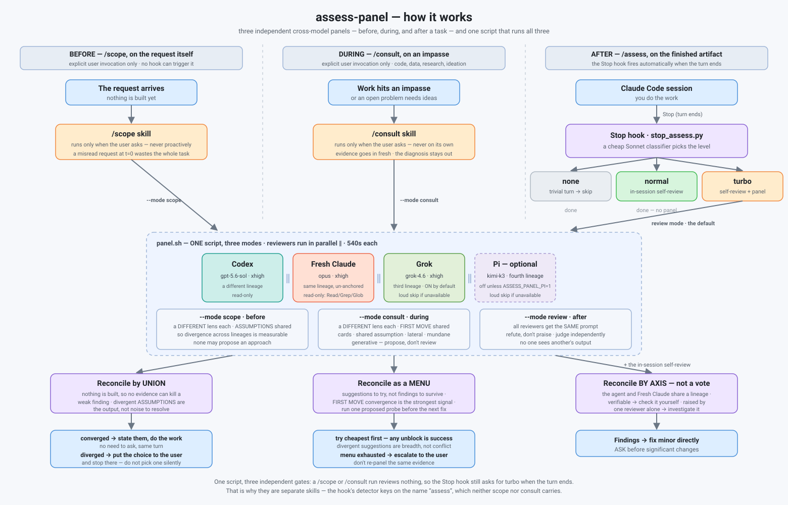

# assess-panel

**A review step for [Claude Code](https://docs.anthropic.com/en/docs/claude-code) that brings in a *different* AI model and a *fresh, un-primed* instance to catch the mistakes the working agent can't see by itself — automatically after substantial work (did it do this right?), or on demand from a single command that reads the moment for itself: before the work, does it even know what you asked? mid-task, what would someone else try?.**

## The problem

When a coding agent finishes a task, the obvious quality check is to have it review its own work. That catches typos, off-by-ones, and forgotten edge cases — real but shallow mistakes. It does **not** catch two deeper failure modes:

- **Model-systematic blind spots.** Every run of the same model shares the same priors. If the model misjudges a class of problem, re-reading its own output misjudges it the same way — you can't out-think your own blind spot using the same brain.
- **Anchoring / "solved the wrong problem."** By the time it reviews, the session has already convinced itself what the task means and that it's done. Reviewing inside that same context inherits the misunderstanding.

## The idea

Add reviewers that **fail differently** from the working agent, so their mistakes don't line up with its blind spots:

- a **different model** — OpenAI's Codex — whose different training catches model-systematic errors;
- a **fresh instance of the same model** with a clean context, which, never having seen the session's reasoning, catches anchoring and wrong-problem errors;
- a **third lineage** — xAI's Grok — on by default, because it needs only its own CLI and a login; when the machine lacks them the panel says so loudly and runs with the rest; and
- optionally a **fourth** — Moonshot's Kimi via the [`pi`](https://pi.dev) agent — off unless you turn it on, because it needs a binary and a provider key this repo can't assume you have.

The point is not "a smarter reviewer." It's **decorrelation**: checkers whose errors are independent of the author's. The chance all of them miss the same bug is far lower than any one alone. Notably this holds *even if the reviewers are no more capable* than the working agent — independence, not capability, is what buys the catch.

Independent review costs tokens and time, so it's **gated**: a cheap classifier decides per turn whether the work is substantial enough to be worth it.

## What it is

Three pieces that plug into Claude Code:

- **An `/assess` skill** — a structured self-review (for code: correctness, edge cases, security, consistency; for research: sourcing and internal consistency; for plans: simplicity and completeness). You can run it by hand (`/assess`), or let the hook trigger it.
- **A Stop hook** — a script Claude Code runs every time the agent finishes a turn. It can block the turn and tell the agent to do something first. Here it classifies the turn into one of three review levels.
- **A `/panel` skill** — the same reviewers, run when you ask rather than when the hook decides, on whichever moment the session is in: *before* the work it reads the **request** and returns what it leaves ambiguous; *during* the work it takes the **problem** — an impasse, an analysis that won't reconcile, an open question — and returns a menu of ways forward. One command; the skill picks the moment from the session, not from you. Deliberately a separate skill rather than a mode of `/assess`; [see below](#the-panel-on-demand-panel) for why the name is load-bearing.



## Three levels (the Stop hook picks one automatically)

- **none** — trivial turn (a reply, a tiny edit). No review.
- **normal** — real but bounded work (a function, a bugfix). The agent reviews its own work in-session.
- **turbo** — a substantial artifact was produced (a new module, a large refactor, a full report). On top of the self-review, it runs the cross-model panel below and reconciles everything.

A cheap classifier (Claude Sonnet, low effort) decides the level on every Stop. You can also force the deepest level yourself with `/assess turbo`.

## The turbo panel

`panel.sh` runs independent skeptical reviewers **in parallel** (wall-clock ≈ the slowest one, not the sum) over the same artifact:

- **Codex** — `gpt-6-astra` at `xhigh` effort; a different model lineage.
- **Fresh Claude** — a clean `claude -p` context, read-only tools (`Read`/`Grep`/`Glob`), no MCP.
- **Grok** *(on by default; `ASSESS_PANEL_GROK=0` disables)* — `grok-4.6` at `xhigh`, its top tier; a third lineage. See [the Grok reviewer](#the-grok-reviewer-on-by-default).
- **Pi** *(optional, `ASSESS_PANEL_PI=1`)* — `moonshotai/kimi-k3` at `high` via OpenRouter; a fourth lineage. See [the fourth reviewer](#the-fourth-reviewer-optional).

All are told to **find problems, not to praise**, and to judge independently. None sees the others' output or any prior review, so their errors stay decorrelated. The reviewer prompt is fixed inside the script (it's a guard — not something the orchestrator rewrites per call), and the *task* handed to them is the original request verbatim, never the agent's summary of what it did (a paraphrase would re-anchor them).

## How findings are combined (turbo)

Not by majority vote — the working agent and the fresh Claude are the same model lineage and correlate. Reconcile **by axis** instead:

- a **verifiable** finding (a real bug, a failing case, a spec mismatch) → check it yourself, fix if real;
- a finding **one reviewer raised and the others missed** → investigate it; cross-lineage disagreement is signal, not a minority to overrule;
- **all agree it's fine** → high confidence, move on.

A 2-1 split is especially not a vote: the working agent and the fresh Claude agreeing against Codex, Grok, or Pi is *one* lineage, not two.

## The panel on demand: `/panel`

`/assess turbo` fires from the hook, on finished work. `/panel` is the one you call yourself, and it runs the same reviewers on whatever the session is holding — **two moments, one command**. Decorrelation is worth more at both of them than it is after the fact: a misread request at t=0 wastes the entire task where a bug at t=1 wastes a fix, and an impasse mid-task is a *demonstrated* blind spot rather than a hypothetical one — the working model's priors have visibly failed on this specific problem, which is exactly when a foreign lineage's priors are worth the most per call.

**The skill picks the moment, not you.** It routes by the *object* — what you are pointing at. Finished work is neither of these two moments: that is `/assess turbo`, and the skill says so in a line and runs it rather than asking. Nothing produced yet, and the object is your request → the before panel. A live problem, or an open question you want ideas on → the during panel. The work state usually separates the last two, and where your wording says otherwise ("what would the panel try") the wording wins, because it is evidence about the object rather than a routing question being handed back to you. What the skill may never do is ask which panel to run.

### Before the work — on the request

The question has to change from turbo's. After the work there is an artifact, so "is this wrong?" is decidable against evidence. Before it there is nothing to refute, and asking two models "how should this be done?" just yields two plausible plans and no way to choose. So the reviewers are asked what they think is being **asked**, never how to do it:

- **Codex** answers a fixed six-slot schema — deliverable, underlying question, assumptions, out of scope, done condition, most likely failure.
- **Fresh Claude** answers **assumptions** first, then runs a **pre-mortem** — wrong question, already done, tractability, hidden cost, misreading risk.
- **Grok** answers **assumptions** first, then bounds the request's **extent** — the minimal and the maximal reading of the same words, where a competent worker's default lands between them and in which direction that misses, the stopping rule, and the spillover (adjacent things touched but not named). Distinct from Pi's lens: different *readings* lead to different work, while minimal/maximal bound the same reading's size.
- **Pi** *(when enabled)* answers **assumptions** first, then enumerates the **competing readings** — every reading that would lead to different work, the single question that would discriminate between them, how far apart they are, and what evidence favours one.

Different lenses on purpose. After the work, a fresh Claude earns its slot by being un-anchored from a session that has convinced itself; at t=0 there is no such anchor, so an identical prompt would make it a second copy of the working agent's own reading. The same argument applies to every added reviewer: asked the same question, each would cost another call for no additional voice.

**Assumptions is the load-bearing slot, and the only one every reviewer answers.** When the request is clear, everything else agrees; assumptions is where independent readers reveal that it wasn't — so it is the one place a genuine cross-lineage comparison exists, and it is shared for exactly that reason. Every other slot is single-source by design, which does not make it weak: the other reviewers were never asked, so their silence is not a dissent.

Aggregation **inverts** from turbo's: union, not survival. Nothing is built, so there is no evidence to kill a weak finding with, and the costs are lopsided — a false alarm takes one sentence to dismiss, a missed misreading costs the whole task. Divergent assumptions are not noise to resolve; they *are* the output, and they go back to the user as an explicit choice.

Two findings only this moment can produce — **tractability** ("the available data cannot support this claim") and the **wrong-question** check ("the answerable version is adjacent to what you asked") — expire as soon as work begins. That is why the moment is keyed on the work rather than on the user's wording.

### During the work — on the problem

Once something has been built, the question inverts a third way. Review asks "is this wrong?" (judicial, survival); the before panel asks "what is being asked?" (interpretive, union); this one asks "what would you try?" — **generative**. The object is a failing check that has survived several attempted fixes, an analysis whose numbers will not reconcile, a dead end — or an open problem the user wants outside ideas on, with nothing failed yet. The counterfactual is looping (often more tokens than the panel costs), or a wrong guess baked into everything downstream until turbo catches it and forces a redo.

Lenses are distinct here too, and for the same reason — "what would you try?" asked identically over the same repo yields the same obvious candidates the session already burned, so the panel would pay three calls for one list:

- **Codex** — **experiment cards**: 2–4 mutually distinct hypotheses, each with a disconfirmer, the cheapest probe that separates it from the others (a command, a query, a calculation, a source to check), and the result it predicts either way — so an outcome cannot be reinterpreted after the fact. Ranked by information per cost, not confidence.
- **Fresh Claude** — the **shared assumption**: treat the failed *attempts*, not the problem, as the object of study; infer the assumption they all share that the request does not require, and attack it. The one question the working model cannot ask itself — it is inside the frame — and therefore the slot where a clean context earns the most. An assumption must quote the attempts that embody it, or be labelled a guess. On an open problem with no attempts, the lens shifts to the **framing**: the assumption embedded in how the question is posed that most constrains the answers.
- **Grok** — **lateral moves**: the space outside the current approach — a different layer, tool, decomposition, data cut or source, an adjacent field's standard method, or the minimal-repro/bisection route that sidesteps theorizing entirely — grounded in what the working directory actually contains.
- **Pi** *(when on)* — the **mundane causes**: stale state or a stale data snapshot, the wrong file/branch/env/dataset actually being exercised, a fix or filter that never took effect, a check or metric asserting something other than it appears to, a join silently duplicating rows, units and timezones — each with the one-line observation that settles it.

All four end with **FIRST MOVE** — the single cheapest next action. It is this moment's counterpart of the before panel's shared assumptions slot: the one place a cross-lineage comparison exists, and convergence there is the strongest signal the run produces. (It comes *last* where the shared slot comes first: an assumption is a reading, answered before the lens can colour it; a first move is a conclusion, worthless un-grounded.)

Aggregation is the easiest of the three: a **menu**. There is a live problem to test suggestions against, divergent suggestions are breadth rather than disagreement, and the run succeeds if any one unblocks. One reconciliation rule is binding: **run at least one proposed probe before the next speculative fix** — a stuck frame that reads the menu, nods, and resumes its own loop has spent the panel on nothing.

**The evidence file is the load-bearing input, and it has rules.** Review's verbatim referent is the artifact and the before panel's is the user's words; this moment has no un-authored source — the stuck session writes the packet, and its *selection* is itself a theory (it pastes the traceback it suspects and omits the config it never did). The skill leans against that, per shape: a failing check is re-run fresh with raw output captured, never from memory or scrollback (and if it passes on the re-run, that is the report); an analysis that won't reconcile gets its queries re-executed and their actual output included, both sides of the contradiction, metric definitions and all; attempts go in as facts — each change and its observed result, abandoned ones included; over-include what was never suspected (config, environment, versions, the check's or metric's own definition), so a consultant *can* disagree about where the problem lives; and exclude the diagnosis entirely — the theory is the thing that has failed. The one exception is the **ideation shape**: nothing failed there, so the current state of thinking goes in *labelled as the state to build beyond* — context, not contamination. Secrets never go in at all (the packet travels verbatim to three providers): no env dumps, no credential files, values named and redacted.

### Domain-neutral, both moments

The slots hold for code, research, analysis, writing, or a decision — only their contents change, so nothing has to classify the task first. Two failure modes that barely exist in coding dominate elsewhere and get their own slots at t=0 (tractability and the wrong-question check), and mid-task the shapes the packet rules name are a failing check, an analysis that will not reconcile, and an open problem — a bug is one case, not the definition.

### When it runs: only when you ask

`/panel` is triggered by an explicit user invocation — typed, or asked for in your own words ("ask the panel", "consult the panel", "get a second opinion", "scope this") — never by the agent's own judgement. The before-work panel ran on judgement for a while; the trigger description fought the agent's default to start working, and the runs it bought were too often ones the user would not have asked for, so the choice was moved to the person who pays for it. Mid-task the pressure runs the other way — the agent's default is to persist, not to spend — but the trigger stays manual for now, and the run counts are what will settle it.

Nothing extra needs registering: the skill's own description carries the trigger rule, and no hook can fire it. The Stop hook fires when a turn *ends*, by which point both of these moments have passed.

A recorded **v2** for the mid-task moment, not built: a `PostToolUse` hook that fingerprints repeated same-failure attempts and compiles the packet mechanically from the transcript, so neither the trigger nor the evidence is authored by the model whose frame failed — the mirror of `stop_hook_active`'s structural-not-hortatory move.

**At most once per episode.** When a before-work run ends by putting a choice to the user, their answer is a *follow-up to that run*: the ambiguity was just resolved by hand, so it is not panelled again. When a mid-task menu is exhausted and the problem still stands, the escalation is to the user with the evidence, not another panel over the same facts.

### Why one skill, and why not a mode of `/assess`

**One skill, because the moment is knowable.** The two moments differ in almost everything that matters — what the caller must build (the user's verbatim words plus optional context, versus an authored evidence packet), what the reviewers are asked, how the output is reconciled, and how the turn ends (put the choice to the user and stop, versus test the cheapest probe and continue). What they do *not* differ in is anything the user has to decide: which moment applies is a fact about whether work has started. Two commands made the user carry a routing decision the session could make for itself, and the generic ask — "ask the panel" — matched only one of them anyway, so a bare request at t=0 landed on the mid-task skill and had to be bounced. One door, and the skill sorts it out.

**Not a mode of `/assess`, because of the name.** The Stop hook's `is_assess_launch()` keys on the literal string "assess" — in the Skill tool's argument, in the harness's launch marker, in the injected skill body's path, and in a typed slash command. It never reads the arguments, so a `/assess scope` run spent the cycle's review flag: the agent could run the before-work panel, do substantial work in the same turn, and reach Stop with the hook already satisfied, shipping it reviewed by nobody. The on-demand panel would silently cancel the after-work one. A skill named `panel` matches none of those four paths, so the two are independent — run the panel, work, and the Stop hook still asks for turbo at the end, which is the correct flow.

Getting there took two false starts, both worth recording because they were the same mistake. Two of those checks were substring scans over a whole injected turn rather than checks anchored to the thing they were about, and an injected *skill body* is such a turn. So a skill whose instructions merely mentioned the review skill's path counted as a completed review — which the panel skill does, in the obvious way, by documenting the `panel.sh` they share. The first fix failed identically: the comment written to warn about the string contained the string. A third channel had the same shape, `is_our_prompt()` matching a bare `"run /assess"` in any isMeta turn, so describing the hand-off in prose read as "we already prompted this cycle" and approved the turn outright.

Both checks are now anchored to what they actually mean — the base-directory line that names the skill, and the hook's own injected reason (`"Run /assess … before finishing"`) — so ordinary prose about assess is just prose. Tests pin both, and fail against the old logic.

What remains load-bearing is only the skill *name*: the other detectors key on it, so a future rename must keep "assess" out of it. `skills/panel/panel.sh` stays as a symlink — no longer required, just one entry point per skill.

### It reviews nothing, on purpose — and the hook knows it

The skill name keeps "assess" out of the Stop hook's detectors, so the after-work review still fires on whatever ships. One addition landed with the mid-task moment: panel reconciliation prose ("the panel proposed…, I tested…, applied the fix") surface-matches the classifier's "reviews work done earlier → NONE" escape hatch, so the turn where a hard bug finally cracked — the turn most deserving turbo — was the one most likely to be classified down, silently. The hook now detects a panel run in the cycle (structurally, the same four channels as the assess detector) and tells its classifier that the work after it is *new, unreviewed* work. The note is gated on the cycle also having edited files. That gate is necessary but not sufficient, because `has_edits` counts *any* `Write` — including the scratch context file the before-work panel builds — so the skill builds that file with a shell redirect instead, and the note itself carves out a scratch panel input as "not work". Without both, a before-work run that ended by handing you a question would look like a turn full of unreviewed work.

### Telemetry

Shares the machinery. Runs log as `mode: scope` or `mode: consult` — the script's own flag names, which predate the skill and still select the two lenses — with no severity counts on the mid-task mode, since its output carries no tags and zeros would read as "reviewed and found nothing". The verdicts you log back answer each moment's own question. Before: `confirmed` = it changed your reading or went to the user as a question, `refuted` = noise. During: `confirmed` = acting on it unblocked the work or changed the approach, `refuted` = tried, dead end, `unverifiable` = untested. The report keeps the modes apart.

## The Grok reviewer (on by default)

The third lineage — xAI's `grok-4.6` via the [grok CLI](https://x.ai/cli) — is **on by
default**, because it needs only the CLI itself and a one-time `grok login` (or an
`XAI_API_KEY`). On a machine without them, every panel prints an explicit `>>> SKIPPED`
naming the cause and continues; `ASSESS_PANEL_GROK=0` turns the reviewer off where that
is permanent.

| Variable | Default | |
|---|---|---|
| `ASSESS_PANEL_GROK` | *(on)* | `0` turns the reviewer off. An unrecognised value is a loud skip, never a guess. |
| `ASSESS_GROK_MODEL` | `grok-4.6` | |
| `ASSESS_GROK_EFFORT` | `xhigh` | grok-4.6's top tier. Unlike pi, the CLI **rejects** a level the model doesn't support instead of clamping, so a bad value is an immediate loud `FAILED`, not a silent downgrade. |
| `XAI_API_KEY` | — | Optional; without it grok authenticates from `~/.grok/auth.json`. **Only the grok reviewer sees it** — it is stripped from the environment codex and claude inherit, same as every other provider key. |

**Read-only and hermetic, like the others.** It runs with `--sandbox read-only` (an
OS-level Seatbelt/Landlock guard on the whole process) plus a `--tools
read_file,grep,list_dir` allowlist that also excludes web search and subagents, and
against a **throwaway `GROK_HOME`** with `auth.json` symlinked in — so it inherits no
default model, no permission mode, and writes nothing into your session history. The
prompt travels via `--prompt-file` with `--verbatim`, so a large diff can't blow the
argv limit and nothing in the artifact is expanded.

Two things the allowlist does *not* cover, because grok's Claude Code compatibility
discovers configuration by `$HOME`, which no throwaway home can redirect. First, **MCP**:
the always-on `search_tool`/`use_tool` meta-tools would expose every server in your
`~/.claude.json` — verified empirically, including write-capable tools — so the panel
passes `--disallowed-tools search_tool,use_tool --deny MCPTool`, after which the probed
tool surface is exactly `read_file`/`grep`/`list_dir`. Second, **skills**: the *names and
descriptions* of your `~/.claude/skills` (and grok's bundled set) stay visible to the
reviewer — there is no pi-style `--no-skills` — which is an instruction-surface residual,
not a data-access one; they are inert unless invoked. And one caveat it shares with
codex: the CLI appends any repo-level `AGENTS.md`/`CLAUDE.md` to its system prompt and
offers no off switch (verified empirically — `--system-prompt-override` does not suppress
it), so a repo's own rules file does reach these two reviewers.

The egress preflight covers it like the others: a grok.com login authenticates against
`cli-chat-proxy.grok.com`, an API key against `api.x.ai`, and a refused CONNECT tunnel to
whichever applies becomes an immediate skip naming the host.

## The fourth reviewer (optional)

Codex, a fresh Claude and Grok are three lineages. A fourth — [`pi`](https://pi.dev) driving
`moonshotai/kimi-k3` over OpenRouter — adds another, in both modes. It is **off by default
and opt-in**, because it needs a binary, a provider key, and (for a
custom model) a machine-local model definition that this repo cannot assume you have:

```bash
ASSESS_PANEL_PI=1 bash skills/assess/panel.sh "$ART" "$TASK"
```

| Variable | Default | |
|---|---|---|
| `ASSESS_PANEL_PI` | *(off)* | `1` turns the fourth reviewer on. |
| `ASSESS_PI_MODEL` | `moonshotai/kimi-k3` | Must be a model `pi --list-models` reports on this machine. |
| `ASSESS_PI_PROVIDER` | `openrouter` | |
| `ASSESS_PI_EFFORT` | `high` | `xhigh` asks for the model's top tier. pi clamps to what the model actually supports (see below). |
| `ASSESS_PI_KEY_FILE` | — | A `.env`-style file to read the key from, for when it lives in a project rather than your shell. **Only the pi reviewer sees it**; codex and claude never do. |
| `ASSESS_PI_KEY_VAR` | derived from provider | e.g. `openrouter` → `OPENROUTER_API_KEY`. |

**It degrades loudly, never silently.** A panel's whole value is decorrelation, so a
reviewer that quietly doesn't run is worse than one that errors — you'd read two sections
and believe three lineages agreed. Before spending a slot, `panel.sh` checks that `pi` is on
PATH, that a credential is resolvable (environment → key file → a provider entry in pi's own
`auth.json`), and that the model actually resolves; each failure prints an explicit
`>>> SKIPPED` naming the cause, and the panel continues with the others. The model check
matters more than it sounds: pi does *not* fail fast on an unknown id — it warns and then
dies at the provider with a `401`, which reads like an auth problem.

**Read-only and hermetic, like the others.** `--tools read,grep,find,ls` is an allowlist over
pi's built-in read-only set (its others are `bash`/`edit`/`write`), and every source of
ambient state is switched off: no session, no extensions or installed packages, no skills, no
prompt templates, and **no `AGENTS.md`/`CLAUDE.md` discovery** — a reviewer that inherits your
own global instructions is not an independent voice. It runs against a throwaway copy of
`~/.pi/agent` rather than the real one, which also keeps it working under Claude Code's Bash
sandbox (pi writes a settings lock and a session dir at startup, which would otherwise EPERM
and kill it before the first token).

**Asking for the top tier needs a one-line config change to be real.** The default effort is
`high`. If you raise it with `ASSESS_PI_EFFORT=xhigh`, note that Kimi K3's reasoning tiers are
`low`/`high`/`max` and pi only offers `xhigh` for a model whose `thinkingLevelMap` defines it.
Without one, `--thinking xhigh` silently clamps *back down* to `high`, so you pay the latency
of asking and get the default anyway. Where the map goes depends on the model:

```jsonc
// ~/.pi/agent/models.json
{"providers": {"openrouter": {
  // a CUSTOM model (not in pi's bundled catalog, e.g. kimi-k3): on its models[] entry
  "models": [{"id": "moonshotai/kimi-k3", "reasoning": true, /* … */
              "thinkingLevelMap": {"off": null, "minimal": null, "low": "low",
                                   "medium": null, "high": "high", "xhigh": "max"}}],
  // a BUILT-IN model: under modelOverrides, so the catalog's context window,
  // max-output and pricing are kept rather than reset to defaults
  "modelOverrides": {"moonshotai/kimi-k2.6": {"thinkingLevelMap": {"xhigh": "max"}}}
}}}
```

Then `xhigh` reaches OpenRouter as `reasoning: {effort: "max"}`. The panel reads both forms:
when it can prove the level clamps it says so, and when the model is configured in neither
place it says the effort could **not** be verified rather than let the header imply otherwise.

**Budget for it being the slowest reviewer.** Kimi K3 lists at $3/$15 per MTok. At `max`
effort on a ~1,100-line diff it overran the default 540s watchdog in our runs while Codex and
Claude finished comfortably — which is why the default here is `high` rather than the top
tier. For a large artifact, still prefer running the panel **backgrounded** with
`ASSESS_PANEL_TIMEOUT=1500` (the 540s default exists to stay under the caller's 10-minute
foreground Bash cap, which backgrounding removes).

## Egress: don't run the panel inside a network sandbox

Every reviewer is a network client, so the one environment guaranteed to break the panel is
the one it is usually called from. Claude Code's Bash sandbox routes outbound traffic through
a host-allowlisted CONNECT proxy; when a provider is not on the list the proxy refuses the
tunnel and the CLI dies *slowly* — codex spends five WebSocket reconnects and a transport
fallback before exiting 1. The log reads like a flaky provider, so the natural response is to
re-run and pay the same minutes again. **Call `panel.sh` with the sandbox disabled** (in
Claude Code, a Bash call with `dangerouslyDisableSandbox`), or allowlist the hosts.

`panel.sh` can't fix this from the inside, so it names it. When a proxy is configured, a
preflight probes each reviewer's endpoint (codex's and grok's are chosen by their auth mode,
pi's comes from the provider's `baseUrl`) and a refused tunnel becomes an immediate `>>> SKIPPED` naming the
host and status, instead of minutes of retries. Two rules keep the diagnostic from costing
more than it saves: it discriminates on the **CONNECT** status, never the HTTP status —
`chatgpt.com` answers a bare `curl` with `403` through a wide-open tunnel — and only a **4xx**
counts, because that is the proxy refusing on policy and no amount of retrying changes it.
Everything else is treated as *no evidence* and never vetoes a reviewer: `000` (no answer, or
a SOCKS proxy, where no CONNECT exchange exists), a `5xx` proxy having a bad moment, an
endpoint the script cannot name, or no `curl` on PATH. With no proxy configured it makes no
network calls at all;
`ASSESS_PANEL_NET_PROBE=0` disables it outright, `ASSESS_PANEL_NET_TIMEOUT` (default 8s) bounds
each probe.

And when the panel ends with no *foreign* lineage having produced a review — codex, grok and
pi all skipped, failed or empty — it says so in a banner rather than printing reconciliation advice
about reviewers that never spoke. A run in which only the fresh Claude answered is the caller's
own lineage checking its own work; that is a self-check, not a panel, and it has to be reported
as one.

## Measuring the panel

The panel costs real minutes and tokens per run, so "is it worth it, and which reviewer
earns its slot?" should not stay anecdotal. The telemetry has two halves, because the two
questions it answers are knowable in two different places:

**What the run itself can know** — `panel.sh` appends one JSONL record per run to
`~/.claude/assess-panel/log.jsonl` (override the path with `ASSESS_PANEL_LOG`;
`ASSESS_PANEL_LOG=off` disables it): the mode, wall time, artifact size, and per reviewer
the status (`ok` / `empty` / `failed` / `timeout` / `killed` / `skipped` + the reason —
the same taxonomy the panel prints), its duration, and how many `[HIGH]`/`[MED]`/`[LOW]`
findings it tagged in review mode. No task or artifact text goes into the record — sizes,
statuses, model names, and the project root path, but nothing from the prompt or the diff.
The fields that carry any free text: a skip reason (the panel's own diagnostic — capped at
300 chars with long token-shaped runs redacted, because one variant quotes a failed
preflight's output) and, in verdict records, the finding summaries you author (refused
over 300 chars: name the finding, don't paste the artifact).
Logging failure is soft: a panel that reviewed the work but could not write its line is a
success, and says so once on stderr. The write happens after every review has printed, so
even a *hanging* log destination cannot eat findings already in hand.

**What only the caller can know** — whether a finding was *right*. Reconciliation happens
in the calling session after the panel exits, so the skill's final step logs it back:

```bash
python3 ~/.claude/skills/assess/panel_stats.py verdict <run-id>   # findings JSON on stdin
```

One entry per reconciled finding: `sources` (every voice that independently raised it —
`codex`, `claude`, `grok`, `pi`, or `self` for the session's own self-review; only voices that
actually delivered in that run are accepted), the `verdict` (`confirmed` / `refuted` /
`unverifiable`), and optionally severity and action. Refuted findings matter as much as
confirmed ones — they are the precision signal — and so do the session's own: a run with
no `self` entries reads as "the self-review found nothing", which inflates the panel's
beyond-self numbers if it just wasn't logged. The footer prints the exact command (with
the log path pinned); `verdict --schema` prints the input shape.

**The answer** — `python3 ~/.claude/skills/assess/panel_stats.py report` joins both halves:

- **Reliability & latency**: per reviewer, how often it actually delivered a review vs
  skipped/failed/timed out (with the top skip reasons), and its median duration.
- **Findings volume**: findings per run by severity, as tagged, plus the median delivered
  output size — so a reviewer whose tags went off-spec is distinguishable from one that
  found nothing.
- **Relevance**, split by mode — never pooled, because the modes' verdicts answer
  different questions (review: "was it real"; scope: "did it change the reading";
  consult: "did acting on it unblock") and scope and consult hand each reviewer its own
  lens, making their findings single-source by design. Per source — including `self`: findings judged next to findings **tagged** (a
  reviewer that tags twelve and gets four reconciled would otherwise score on its best
  four — flooding is the main way a panelist fails to earn its slot), precision over the
  settled ones (`confirmed / (confirmed + refuted)`; unverifiable ones are excluded, being
  facts about the artifact's checkability rather than the reviewer's judgement),
  **unique** confirmed catches (that source alone raised it), **beyond-self** confirmed
  catches (the session's own review missed it), and **beyond/run** — the same, as a rate
  over the runs the source delivered a judgement in (an empty "no findings" review counts:
  it was an opportunity that yielded nothing), so an opt-in reviewer isn't punished for
  being asked less often. The last two are the panel's whole reason to exist, priced per
  reviewer.

Caveats the report states itself: verdicts are judged by the same session whose work was
reviewed, so precision means "survived the caller's checking", not ground truth — fine for
comparing reviewers against each other, which is the question. Beyond-self is only as
honest as the caller's `self` logging, so the report prints self-coverage next to it. And
the severity counts are a volume signal only (a reviewer quoting a tag inflates them); the
verdicts are the real measure.

## Keeping the provider key out of your transcripts

`ASSESS_PI_KEY_FILE` / `ASSESS_PI_KEY_VAR` exist so the key can live outside `models.json`, and
it is worth using them — or better, keeping the secret out of any file at all. pi resolves
`apiKey` three ways: a **literal**, an **env-var name**, or a **`!command`** whose stdout is the
key. On macOS the last one turns the config into a pointer:

```jsonc
// ~/.pi/agent/models.json
{"providers": {"openrouter": {"apiKey": "!security find-generic-password -w -s openrouter-api-key"}}}
```

```bash
# store it once (the value goes in over stdin, so it never reaches the process table)
printf '%s\n%s\n' "$KEY" "$KEY" | security add-generic-password -a "$USER" -s openrouter-api-key -T /usr/bin/security -U -w
```

A literal key in `models.json` is a live credential in a file that gets printed — by you, or by
an agent asked a perfectly reasonable question about which models are configured, at which
point it is in a transcript forever. `panel.sh` treats a non-identifier `apiKey` as the provider
authenticating itself and never echoes the value, but the file is still the exposure. An
env-var name is the portable alternative; note it puts the key in every child process's
environment, where an `env` dump will find it.

## Requirements

- **Claude Code** (`claude` CLI), authenticated.
- **Codex** (`codex` CLI ≥ 0.153.1), authenticated. Model and effort are pinned to `gpt-6-astra` / `xhigh` (override with `ASSESS_CODEX_MODEL` / `ASSESS_CODEX_EFFORT`).
- **Grok** (`grok` CLI — `curl -fsSL https://x.ai/cli/install.sh | bash`), authenticated via `grok login` or `XAI_API_KEY`. On by default; without it every panel prints a skip naming the cause (`ASSESS_PANEL_GROK=0` silences that permanently).
- macOS or Linux (the hook and `panel.sh` are bash + standard tools).
- *Optional, only for the fourth reviewer:* **pi** (`npm i -g @mariozechner/pi-coding-agent`), a provider key, and `ripgrep` on PATH (without it the reviewer keeps `read`/`ls` but loses `grep`/`find`, and says so).

## Files

- `hooks/stop_assess.py` — the 3-level gate (the Sonnet classifier).
- `skills/assess/SKILL.md` — the after-work instructions: normal + turbo branches.
- `skills/panel/SKILL.md` — the on-demand instructions, both moments: how the moment is chosen, the verbatim-request rule and the evidence-packet rules, union versus menu reconciliation. Separate skill (see above for why the name matters).
- `skills/assess/panel.sh` — runs the reviewers in parallel. `--mode review` (default) on a finished artifact; `--mode scope` on a request that hasn't been started; `--mode consult` on a stuck state mid-task. Appends one telemetry record per run (see "Measuring the panel").
- `skills/assess/panel_stats.py` — the other half of the telemetry: `verdict` logs the caller's reconciliation, `report` aggregates per-reviewer reliability and relevance, `runs` lists recent run ids.
- `test/test_panel_grok.py` — pins the grok reviewer's gating: on by default, loud when unavailable, hermetic and read-only, key isolation, and never rendered as agreement when it dies.
- `test/test_panel_pi.py` — pins the pi reviewer's gating: off by default, loud when enabled-but-unavailable, and never rendered as agreement when it dies.
- `test/test_panel_log.py` — pins the telemetry: record correctness per outcome, soft-fail logging, no secrets in the log, and the verdict/report loop.
- `test/test_panel_consult.py` — pins the mid-task (`--mode consult`) panel: the problem statement is required, the lenses stay distinct while FIRST MOVE stays shared, the footer reconciles as a menu, and telemetry records the mode without severity counts.
- `skills/panel/panel.sh` — a symlink to the script above, not a copy, so the skill cites a path inside its own directory. Deleting it breaks the skill.
- `install.sh` — symlinks the hook + skill into `~/.claude/` (backs up anything already there).

## Install

Review the files, then:

```bash
bash install.sh
```

**Upgrading from a checkout that still had `/scope` and `/consult`: re-run `install.sh`.** The hook is symlinked, so a `git pull` alone switches it to looking for the `panel` skill while `~/.claude/skills/` still holds two links pointing at directories this repo no longer has — `/panel` missing, the two retired commands dangling. The installer links `panel` and removes those two links.

It backs up any existing `~/.claude/hooks/stop_assess.py` and `~/.claude/skills/{assess,panel}` into `~/.claude/backups/` (outside the skills dir, so backups don't show up as live skills), then symlinks this repo in their place (so edits here go live immediately). You must also register the Stop hook once in `~/.claude/settings.json`:

```json
{
  "hooks": {
    "Stop": [
      { "hooks": [ { "type": "command", "command": "python3 ~/.claude/hooks/stop_assess.py" } ] }
    ]
  }
}
```

## Notes

- All reviewers run **read-only** — they cannot edit your files.
- `panel.sh` defaults to `--mode review`, so existing callers are unaffected; `--mode scope` (or `ASSESS_PANEL_MODE=scope`) selects the before-work panel, `--mode consult` the mid-task one. In scope mode the file argument is the *context* bundle rather than an artifact, and may be empty; in consult mode it is the *evidence* bundle (empty is accepted but weakens every lens). In both, the request/problem is the second argument and is required.
- `/panel` runs only on an explicit user invocation, never on the agent's own judgement and never from a hook — nothing to register beyond the Stop hook below. Which of its two moments applies is decided by the skill from the state of the session, not asked of the user.
- Per-reviewer timeout defaults to 540s (`ASSESS_PANEL_TIMEOUT` to override).
- The panel reviewers root in the project directory (`$PWD`, or `ASSESS_PANEL_ROOT`) so they can read the surrounding code, not just the artifact text.
- The hook prompts **at most once per stop-chain**: on any Stop that follows its own block (`stop_hook_active`), it approves — however the agent handled the prompt. This is what makes "assess the assessment" loops structurally impossible.
- The hook **fails open**: if the classifier CLI errors or times out, the turn is approved with a stderr note — an infra hiccup never manufactures a review demand.
- Turns with **no tool calls at all** (a reply, a recap, an explanation) are approved without classifying — there is no artifact to review.
